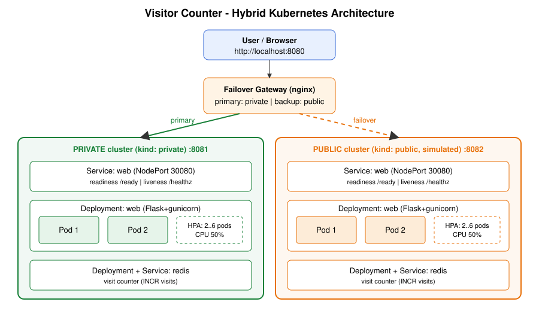

# Visitor Counter on Kubernetes (Flask + Redis)

Containerized Flask + Redis app deployed on Kubernetes with autoscaling, a hybrid
(private + simulated public) deployment with failover, and a measured cost analysis.



## Repo layout
```
app/                 Flask app + requirements
Dockerfile           optimized multi-stage Alpine image (after)
Dockerfile.before    naive baseline image (for cost comparison)
docker-compose.yml   local run (Task 1)
k8s/                 redis.yaml, web.yaml, hpa.yaml (+ before/ baseline manifests)
hybrid/              kind cluster configs, nginx failover gateway
scripts/             setup, demos, cost measurement
docs/                architecture diagram, cost analysis
screenshots/         evidence for each task
```

## Prerequisites (macOS, Apple Silicon)
```bash
brew install --cask docker      # Docker Desktop
brew install kind kubectl
```
Open Docker Desktop -> Settings -> Resources: give it **>= 6 CPUs and 8 GB RAM**
(your Mac has 16 GB, so this is fine). Images build natively for arm64.

## Task 1 - Containerize and run with Docker Compose
```bash
docker compose up --build
open http://localhost:5000          # refresh: counter increments
curl localhost:5000/api/count
docker compose down
```
Screenshot: `docker compose ps` + browser.

## Tasks 2-4 - one-shot cluster setup
```bash
./scripts/setup.sh
```
Creates two kind clusters (`private` on :8081, `public` on :8082), installs
metrics-server, deploys Redis + web (2 replicas, requests/limits, readiness and
liveness probes) and the HPA to both, and starts the nginx failover gateway on :8080.

### Task 2 - Deploy and self-healing
```bash
kubectl --context kind-private get deploy,svc,pods
kubectl --context kind-private describe deploy web | grep -A6 -E "Limits|Requests|Readiness"
./scripts/demo-selfheal.sh          # deletes a pod, watch it get replaced
```
Screenshots: pods running, then the delete + replacement.

### Task 3 - HPA (min 2, max 6, 50% CPU)
```bash
kubectl --context kind-private get hpa
./scripts/demo-hpa.sh               # ~11 min; log saved to screenshots/hpa-log.txt
# in a second terminal:
kubectl --context kind-private get hpa web -w
```
The app's `/load` endpoint burns CPU so scaling is reliable. Record the
replica timeline from `screenshots/hpa-log.txt` in the table below.

| Time | CPU / target | Replicas |
|---|---|---|
| (fill from hpa-log.txt) | | |

### Task 4 - Hybrid cloud + failover
Both clusters run the identical manifests; the page shows which cluster served you.
```bash
open http://localhost:8080          # shows private-cluster
./scripts/demo-failover.sh          # stops private, traffic moves to public-cluster
```
Notes:
- The "public cloud" is simulated by a second kind cluster. To use a real one
  (GKE/EKS/AKS free tier), push the image to a registry, point `image:` in
  `k8s/web.yaml` at it, apply the manifests with that kubeconfig context, and set
  the gateway's backup upstream to its external IP.
- Each cluster has its own Redis, so counts are independent per cluster (a
  known limitation of this demo; a shared managed Redis would fix it).

## Task 5 - Cost optimization
```bash
./scripts/cost-measure.sh before    # deploys baseline, records measurements
./scripts/cost-measure.sh after     # deploys optimized, records measurements
./scripts/cost-measure.sh report    # prints the before/after table
```
See [docs/COST_ANALYSIS.md](docs/COST_ANALYSIS.md) for techniques and the table.

## Cleanup
```bash
./scripts/teardown.sh
```

## Screenshot checklist (save into `screenshots/`)
1. `docker compose ps` and the app in the browser
2. `kubectl get pods,svc` (2 web pods + redis Running)
3. Pod deletion and replacement
4. `kubectl get hpa -w` showing 2 -> up to 6 replicas under load, then scale down
5. Gateway page showing `private-cluster`, then `public-cluster` after `docker stop private-control-plane`
6. Cost table output from `cost-measure.sh report`
